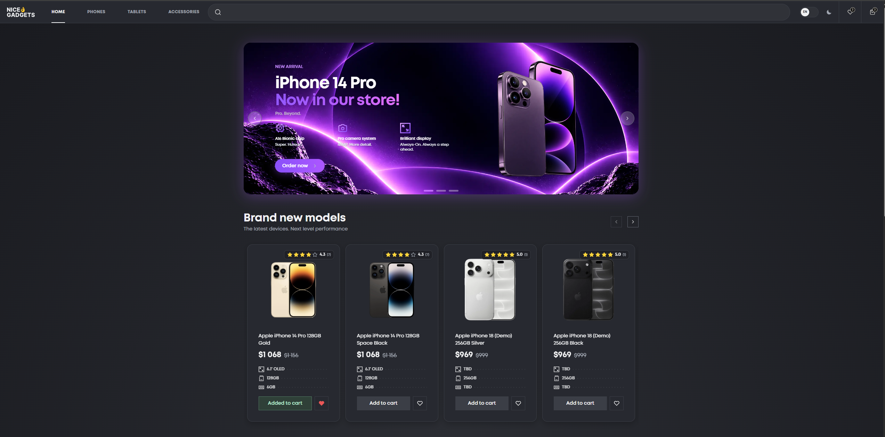
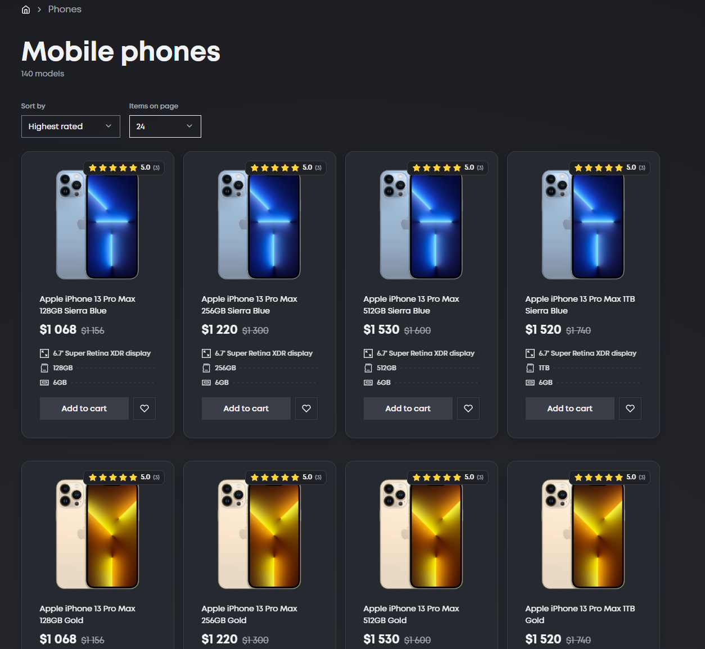
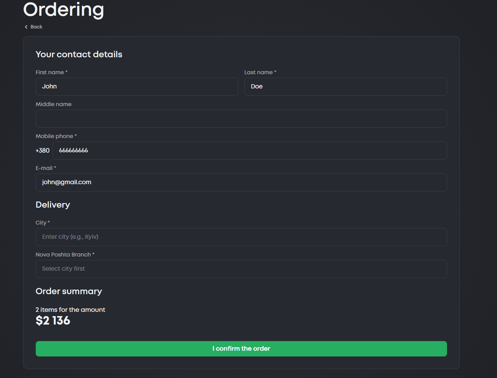

# 🛍️ NICE GADGETS

<p align="center">
  
  
  
  
  
</p>

<p align="center">
  <b>We sell gadgets. You buy things you probably don't need. Everyone wins.</b>
</p>

<p align="center">
  🌐 <a href="https://nicegadgets.online">Live Website</a> •
  💻 <a href="https://github.com/Localhost-Enterprises/group-project-2026">GitHub Repository</a>
</p>

---

## 📖 About the Project

Welcome to **NICE GADGETS** — another e-commerce platform, because apparently the internet didn't have enough of those.

Built by a group of developers who decided that creating an online gadget store would be a perfectly reasonable way to spend their time.

Our mission is simple: make browsing electronics unnecessarily enjoyable and purchasing things you didn't plan to buy dangerously convenient.

Under the sarcasm, there's an actual application built with modern technologies, reusable components, proper state management, and a backend that (hopefully) knows what it's doing.

**It's not rocket science. It's just a lot of React.**

## ✨ Features

Things we actually spent time implementing:

- **Product Catalog** — because scrolling through products is a hobby now.
- **Product Details** — specifications, variants, and enough information to justify your purchase.
- **Product Variants** — different colors and storage capacities, because decisions are hard.
- **Shopping Cart** — where financial responsibility goes to die.
- **Product Discovery** — find something you didn't know you wanted five minutes ago.
- **Responsive Design** — works on different screen sizes, unlike some of our life decisions.
- **Internationalization** — because the internet doesn't speak just one language.
- **Interactive UI** — sliders, galleries, and other things that make a website feel alive.

## 🖥️ Screenshots

A rare opportunity to look at something we built instead of staring at the console.

<div align="center">
  <h3>🏠 Homepage</h3>
  

  <h3>📱 Product Catalog</h3>
  

  <h3>📦 Product Details</h3>
  

  <h3>🛒 Checkout</h3>
  
</div>

## 🛠️ Tech Stack

We didn't reinvent the wheel. We just installed several libraries to make it spin.

### Frontend

| Technology        | Purpose                                                |
| ----------------- | ------------------------------------------------------ |
| React 19          | Making components argue with each other                |
| TypeScript        | Catching mistakes before users do                      |
| Vite 8            | Making development slightly less painful               |
| Tailwind CSS 4    | Writing CSS without writing CSS                        |
| Sass              | Because apparently we needed more ways to style things |
| Styled Components | Yet another way to style things                        |
| React Router 7    | Making sure users get somewhere                        |
| Swiper            | Smooth sliding, unlike our deadlines                   |

### State Management & Backend

| Technology     | Purpose                                          |
| -------------- | ------------------------------------------------ |
| Zustand        | Keeping application state under control (mostly) |
| TanStack Query | Fetching data and pretending everything is fine  |
| Supabase       | Storing data somewhere that isn't a spreadsheet  |
| EmailJS        | Sending emails without becoming an email server  |
| i18next        | Teaching the application other languages         |

### Code Quality & Development

- **ESLint** — because bad code deserves consequences.
- **Prettier** — making everyone's code look equally organized.
- **Husky** — the last line of defense before questionable commits.
- **TypeScript** — because `any` is not a personality trait.

## 🚀 Getting Started

Want to run this locally? Bold choice.

### Prerequisites

You'll need:

- [Node.js](https://nodejs.org/)
- npm
- Git
- A functioning terminal and a reasonable amount of patience.

### 1. Clone the repository

```bash
git clone https://github.com/Localhost-Enterprises/group-project-2026.git
```

Congratulations. You now own a copy of our problems.

### 2. Navigate to the project directory

```bash
cd group-project-2026
```

### 3. Install dependencies

```bash
npm install
```

Give it a moment. There are quite a few of them.

### 4. Configure environment variables

Create a `.env` file in the root directory:

```env
VITE_SUPABASE_URL=your_supabase_project_url
VITE_SUPABASE_PUBLISHABLE_KEY=your_supabase_publishable_key
```

Replace the placeholders with your actual Supabase credentials.

No credentials, no backend. It's a surprisingly consistent rule.

### 5. Start the development server

```bash
npm run dev
```

Open the URL provided by Vite, usually:

```text
http://localhost:5173
```

And there you go. It lives.

## 📜 Available Scripts

Because typing commands is cheaper than clicking random things.

| Command                | Description                               |
| ---------------------- | ----------------------------------------- |
| `npm run dev`          | Start the development server              |
| `npm run build`        | Type-check and build the application      |
| `npm run preview`      | Preview the production build              |
| `npm run typecheck`    | Ask TypeScript if we've made mistakes     |
| `npm run lint`         | Fix what ESLint can fix                   |
| `npm run lint:check`   | Find questionable code                    |
| `npm run format`       | Make the code look civilized              |
| `npm run format:check` | Check whether civilization has collapsed  |
| `npm run fix-style`    | Run formatting and linting                |
| `npm run check`        | Run the code quality checks               |
| `npm test`             | Run automated tests and hope for the best |

## 📁 Project Structure

Organized enough to look like we know what we're doing.

```text
group-project-2026/
│
├── .github/             # GitHub configuration
├── .husky/              # Git hooks (the commit police)
├── public/              # Static assets
├── src/                 # Where most of the magic happens
├── tests/               # Automated tests
│
├── .env.example         # Environment variables template
├── eslint.config.js     # ESLint configuration
├── index.html           # HTML entry point
├── package.json         # Dependencies and scripts
├── render.yaml          # Deployment configuration
├── tsconfig.json        # TypeScript configuration
├── vite.config.ts       # Vite configuration
└── README.md            # You're reading it. Obviously.
```

## 🚢 Deployment & Continuous Integration

Our application is hosted on **Render**.

🔗 **Live Application:** [https://nicegadgets.online](https://nicegadgets.online)

### Automatic Deployment

We believe in automation. Mostly because doing things manually is exhausting.

Our repository is connected to Render, which automatically deploys changes pushed to the configured branch.

The process looks something like this:

1. Someone pushes code to GitHub.
2. Render notices the new commit.
3. Dependencies get installed.
4. The production build gets generated.
5. The updated website goes live.

No manual deployment rituals. No uploading files by hand. Just push and let automation do its thing.

**Build command:**

```bash
npm ci && npm run build
```

**Publish directory:**

```text
dist
```

The application also uses URL rewriting to keep client-side routing working.

In theory, everything is automatic. In practice, that's why we have logs.

## 🔐 Environment Variables

The application requires:

| Variable                        | Description              |
| ------------------------------- | ------------------------ |
| `VITE_SUPABASE_URL`             | Supabase project URL     |
| `VITE_SUPABASE_PUBLISHABLE_KEY` | Supabase publishable key |

**A friendly reminder:** Never commit private credentials, secret API keys, or anything else you'd rather not see on the internet.

Git is forever. Regrets are optional.

## 👥 Team

Built by **Localhost Enterprises**.

A group of developers, a questionable number of commits, countless decisions, and one shared goal: getting this thing to production.

**Organization:** [Localhost Enterprises](https://github.com/Localhost-Enterprises)

**Repository:** [group-project-2026](https://github.com/Localhost-Enterprises/group-project-2026)

## 📄 License

No license has been specified for this project yet.

Until then, all rights and responsibilities remain appropriately undefined.

---

<p align="center">
  <b>NICE GADGETS</b>
  <br />
  We make websites. You make questionable purchases.
  <br /><br />
  Made with ❤️, ☕, and an unhealthy amount of debugging.
  <br />
  <sub>Works on our machines™</sub>
</p>
